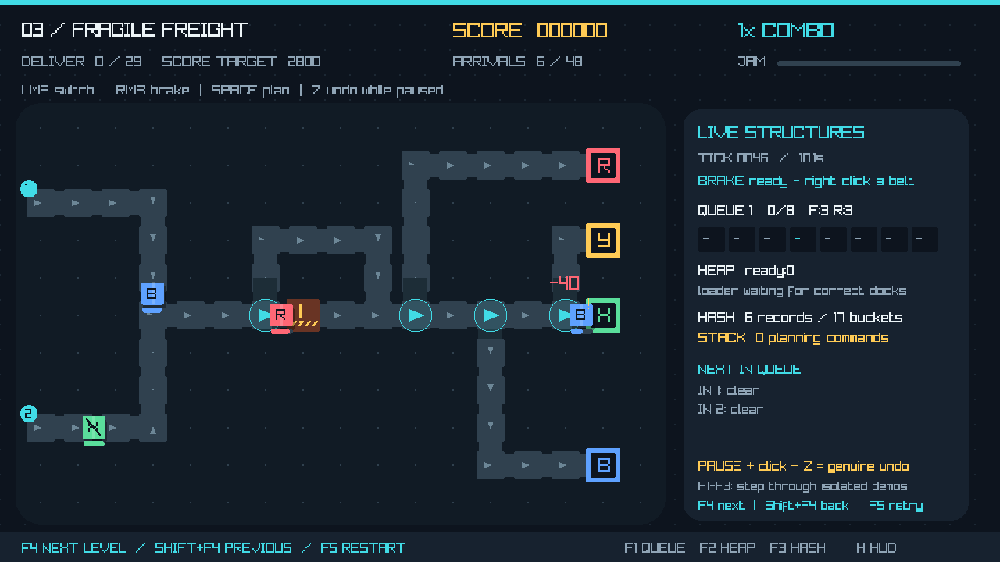

# Parcel Panic: Conveyor Mayhem 📦

**Route parcels. Beat deadlines. Keep the factory moving.**

A C++17/Raylib arcade game and university DSA project, developed for **Windows 11 using VS Code and MinGW-w64**.

Switch conveyor junctions to send parcels to matching delivery docks. Build combos, avoid jams, protect fragile freight, and survive increasingly busy shifts.

## 🎮 Features

- Four playable levels with different conveyor layouts.
- Red, blue and yellow destinations, express deadlines, fragile parcels and damaged parcels for recycling.
- Emergency brakes, rush waves, combos, scoring and victory/failure screens.
- Pause to plan routes and undo junction changes.
- Animated belts, moving parcels, particles and a live DSA panel.
- F1–F3 demonstrations using the actual custom data structures.
- Instant F4 level skipping for the instructor's demo.

## 📚 DSA concepts

| Structure | Implementation | Gameplay role |
|---|---|---|
| Circular queue | Dynamic array, front/rear indices, wraparound | Incoming parcel buffers |
| Min-heap | Dynamic array, deadline/sequence ordering | Earliest-deadline dispatch at the shared loader |
| Hash table | Linear probing, tombstones and rehashing | Parcel tracking by unique ID |
| Linked stack | Singly linked nodes | Undo paused junction changes |

These structures are implemented from scratch, with destructors and copying disabled. No STL containers replace them. Queue operations and stack push/pop are O(1); heap operations are O(log n), with O(n) growth; hash lookup is expected O(1), worst O(n). Full details are in [COMPLEXITY.md](docs/COMPLEXITY.md).

## ⚙️ What you need — Windows

1. **VS Code** with Microsoft's **C/C++** and **CMake Tools** extensions. VS Code will recommend them when you open the folder.
2. **MinGW-w64**: `gcc`, `g++` and `mingw32-make` available on PATH. For F5 debugging, also install `gdb`.
3. **CMake 3.22 or newer**, added to PATH during installation.
4. Internet access for the first build. CMake downloads Raylib automatically; no manual Raylib or vcpkg setup is needed.

If the same MinGW compiler already builds your PC-Builder-Tycoon project, you can use it here too. **Visual Studio is not required.**

### If you do not have MinGW yet

Install [MSYS2](https://www.msys2.org/), open its **UCRT64** terminal, and run:

```text
pacman -S --needed mingw-w64-ucrt-x86_64-gcc mingw-w64-ucrt-x86_64-make mingw-w64-ucrt-x86_64-gdb
```

Add the installation's `ucrt64\bin` folder to your Windows user PATH (normally `C:\msys64\ucrt64\bin`). Install [CMake](https://cmake.org/download/) and choose its **add to PATH** option. Close and reopen VS Code afterward.

In a new VS Code terminal, these commands should show installed versions:

```powershell
g++ --version
mingw32-make --version
cmake --version
```

## 🚀 Download, build and play

### 1. Download

Click **Code → Download ZIP** on GitHub and extract the ZIP. Open the extracted project folder in **VS Code**.

### 2. Build

Press **Ctrl+Shift+B**, or run this in the VS Code terminal:

```powershell
.\build.bat
```

The script downloads Raylib on the first build, compiles the entire project, and runs the automated tests. Wait for **“Build and tests passed.”**

### 3. Play

Double-click **`ParcelPanic.exe`** inside the generated **`build`** folder, or run:

```powershell
.\build\ParcelPanic.exe
```

You can also choose **Terminal → Run Task → Run ParcelPanic**. To debug, press **F5**; the supplied VS Code configuration builds Debug and uses GDB. Once the game has keyboard focus, its F5 key restarts the current level.

After changing a `.cpp` or `.h` file, save it and press **Ctrl+Shift+B** again. Build the whole project; the single-file “Run Code” command will not link the other source files or Raylib.

## 🕹️ Controls

| Input | Action |
|---|---|
| Left click | Switch a cyan junction |
| Right click | Temporarily brake a conveyor cell; shared cooldown |
| Space / Esc | Pause/resume planning |
| Z while paused | Undo a junction change |
| H | Show/hide the live DSA panel |
| R / F5 | Restart the level |
| F1 / F2 / F3 | Open queue / heap / hash demonstrations |
| Enter / Backspace / Esc in a demo | Next operation / reset / close |
| F4 / Shift+F4 | Next / previous level immediately |

F4 wraps from level 4 to level 1. Shift+F4 wraps backward. Skipping resets the run and awards no victory. You can also choose any level from the title screen.

## 🏭 Four levels

| Level | Main challenge | Arrivals | Required deliveries | Score target |
|---|---|---:|---:|---:|
| Sort School | Two colors, two input lanes, introductory routing | 20 | 12 | 1,200 |
| Rush Junction | Three colors, merging lanes and rush waves | 38 | 23 | 2,300 |
| Fragile Freight | Crusher bypass, express/fragile parcels and recycling | 48 | 29 | 2,800 |
| Mayhem Mode | Vertical sorter, all parcel types and a slower loader | 60 | 36 | 3,600 |

Match parcel letters to docks: **R**, **B**, **Y**, and **X** for damaged/recycling. **F** means fragile; **!** means express. Reach both the quota and score target. Wrong docks, missed deadlines and broken fragile parcels break your combo. A full jam meter ends the shift.

## 📸 Screenshot

Actual in-game capture:



## 🧱 Project structure

```text
.vscode/                 VS Code build tasks, debugger and extension settings
.github/workflows/       Windows MinGW build and test workflow
build.bat                Build the game and run tests on Windows
CMakeLists.txt           C++17 targets and automatic Raylib download
src/
  main.cpp
  module1_conveyor/      Queue, stack and conveyor routing
  module2_dispatch/      Hash table, heap and dispatch
  shared/                Game, renderer, levels and demonstrations
include/                 Class headers and Config.h tuning constants
tests/                   C++ tests and test-case list
docs/                    Academic report, design, team plan and test results
README.md
CONTRIBUTING.md
.gitignore
```

The intended split is Member 1 for routing/queue/stack, Member 2 for tracking/heap/hash/dispatch, and both for presentation, levels, integration and documentation. This is planned responsibility, not a claim of human authorship of the generated prototype.

## ✅ Tests

`build.bat` runs the C++ tests automatically. To run them again:

```powershell
ctest --test-dir build --output-on-failure
.\build\parcel_tests.exe
```

The current suite has **16 test groups and 6,938 checks**, including complete winning playthroughs of all four levels. See [TESTING.md](docs/TESTING.md) for actual results and verification limits. The Windows CI workflow runs `build.bat` and saves the built EXE as an artifact; a green hosted run is not claimed until GitHub executes it.

## 📤 Sharing on GitHub

Upload the source files and folders above, including `.vscode`. Do not upload the generated `build`/`out` folders or downloaded Raylib sources. The `.gitignore` excludes build output.

For people who only want to play, attach the built **`ParcelPanic.exe`** to a GitHub Release. The MinGW build links its compiler runtimes statically and uses no external game assets. A compatible Windows machine should only need that EXE; verify it on a clean Windows 11 machine before publishing a playable release. A source ZIP still needs the compiler setup described above.

## Notes

- This repository's intended user workflow is Windows 11 + VS Code + MinGW. No Linux, Visual Studio, vcpkg or preset setup is needed.
- A real 64-bit Windows EXE was cross-compiled and checked for system-only DLL imports. Local Windows execution and clean-machine testing are still needed; no sound or saved high scores are included.
- Tune gameplay in `include/Config.h`. See [REPORT.md](docs/REPORT.md), [ARCHITECTURE.md](docs/ARCHITECTURE.md) and [TEAM_PLAN.md](docs/TEAM_PLAN.md) for the academic material.
