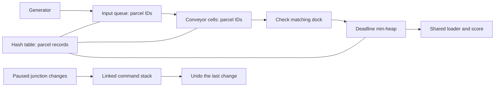

# How the game fits together

## Three modules

| Module | Files | Main jobs |
|---|---|---|
| Conveyor and Routing | `src/module1_conveyor` | Circular queues, linked undo stack, belt movement, merges, junctions and brakes |
| Parcel Tracking and Dispatch | `src/module2_dispatch` | Hash-table records, deadline heap, loader timing, parcel status, penalties and scoring |
| Shared Game and Presentation | `src/shared`, `src/main.cpp` | Four level layouts, simulation timing, input, menus, animation and DSA demos |

`Simulation` brings the first two modules together. `Game` handles the window, input and timing; `Renderer` reads the state to draw it. The `parcel_core` build target contains the game logic and DSA demos and does not need Raylib.

## Follow one parcel

The hash table holds the actual parcel records. Queues, cells and heap entries store IDs and look up those records when needed. They do not keep pointers into the table because growing the table moves its records to a new array.

A normal parcel passes through these statuses:

`Created → Queued → OnConveyor → AtDock → Ready → Dispatched`

`AtDock` is a brief check inside the arrival function. A wrong dock changes the status to `Rejected`; a fragile parcel entering a crusher becomes `Broken`; a missed deadline becomes `Expired`. Damaged parcels must reach recycling, then use the same heap and loader as other correct deliveries.

Finished records stay in the hash table until restart so they can still be inspected. An expired ID may remain in a queue, cell or heap until that structure next processes it. Its finished status prevents further movement, scoring or repeated penalties.

## What happens in one tick

`Simulation::step()` performs these operations in order:

1. Increase the tick counter and clear planning undo history.
2. Try to generate a parcel when an arrival is due. A full input queue makes it wait.
3. Check deadlines and let the shared loader dispatch at most one ready parcel when its loading interval allows it.
4. On a movement tick, move parcels, feed input queues onto belts and update congestion.
5. Check whether the level has ended.

Dock arrivals happen after that tick's loader check, so they wait until a later tick to be loaded.

During movement, `occupancy[]` remembers the cells occupied at the start, and `claimed[]` marks empty cells already taken in this pass. A parcel cannot enter a cell that was occupied at the start, even if its occupant moves away. This keeps one parcel per cell and prevents swaps and double moves. The scan starts at a different position each tick so one merge branch is not always checked first. A brake stops the chosen cell and movement into it.

## Time and animation

Graphics target 60 frames per second; the simulation advances once every **0.22 seconds**. A time accumulator decides when the next tick is due. Each frame advances animation to a tick boundary, runs the tick, then uses any remaining frame time. A single frame's time is capped at **0.1 seconds**, so a stalled window does not suddenly run many ticks.

`Game` keeps a fixed `ParcelMotion` array indexed by ID. Each visible parcel moves between cell centers using `elapsed / duration` as its progress. Travel finishes slightly before the next routing decision. These visual positions do not change logical cell occupancy or replace a data structure.

Each parcel's status change produces feedback once. Its `eventCell` and `pointsAwarded` keep the correct location and reward, including when several parcels finish together. A fragile parcel visually reaches the crusher before its failure effect appears. Junction arrows turn from their current angle, and each belt edge keeps its scrolling position when braked.

## Pause and restart

Pause and F1–F3 demos freeze the live simulation, parcels, belts, deadlines, rushes, cooldowns and world effects. Paused junction clicks and Z undo still update the junction arrow. The next simulation tick clears the undo stack, so it cannot rewind past parcel movement.

`Simulation::load()` resets the level's structures, counters, score, jam, time and outcome. The game also clears motion records, effects and animation timers. F4/Shift+F4, F5/R, Retry and level cards all use this reset path. Skipping wraps between the four levels, discards the old run and awards no victory. High scores are not saved between runs.

## Window scale and input

The layout uses 1280 × 720 coordinates and is displayed at **1360 × 765**. `Config::WindowScale` is 1.0625, making everything 6.25% larger. A Raylib `Camera2D` applies this zoom; `SetMouseScale` converts mouse positions back to the layout coordinates. Buttons, junctions and parcel hover therefore use the same positions as before.

`Ui::clip()` scales the clipping rectangles too, because Raylib expects those in actual window pixels. Fonts are loaded at the displayed size. The input-queue IDs, last-departure label and nearby details also use larger text, with shorter labels to leave enough space.

## Drawing and fonts

- `Renderer.cpp` draws the factory and sidebar.
- `Screens.cpp` draws menus, level previews, results and demos.
- `Ui.cpp` supplies shared button rectangles, drawing helpers and font loading.

Graphics use Raylib rectangles, lines, circles and basic maths. There are no extra shader, physics or animation libraries. Tomorrow Medium and SemiBold fonts and their license are included in `assets/fonts`; CMake copies them beside the EXE. Paths are based on the EXE's location so double-clicking and launching through VS Code find the same files. Fonts load after the window opens and unload before it closes. No separate art or audio download is needed.

## Class reference

The following functions connect the modules. See [CODE_GUIDE.md](CODE_GUIDE.md) for syntax and includes, and [COMPLEXITY.md](COMPLEXITY.md) for time and storage costs.

### CircularQueue

Owns a fixed-capacity dynamic `int[]` containing parcel IDs.

| Function or field | Meaning |
|---|---|
| `enqueue(id)` | Add at the rear; return `false` if full |
| `dequeue()` | Remove and return the front ID; return `-1` if empty |
| `peek()` | Read the front ID without removing it; return `-1` if empty |
| `front`, `rear` | Start at `0` and `-1`; rear means the **last inserted** slot |
| `size()`, `getCapacity()`, `getFront()`, `getRear()`, `getSlot(index)` | Let drawing code inspect the actual queue |

Removed slots contain `0`; valid gameplay IDs start at `1`. `clear()` empties the queue but keeps its allocation.

### CommandStack and ConveyorSystem

`CommandStack` owns linked `StackNode` objects. Each `SwitchCommand` stores a junction's cell and old outgoing choice. `push(command)` adds at the top; `pop()` removes the newest command, returning `cell == -1` if empty. Gameplay checks `isEmpty()` before undo. `clear()` deletes all nodes.

`ConveyorSystem` owns the grid, input queues and undo stack. Cells store parcel IDs.

- `move(HashTable&, DispatchSystem&, tick)` performs one movement pass; `feed(HashTable&, tick)` admits waiting parcels onto input belts.
- `switchJunction(index, planning)` changes a route and records its old choice only during planning.
- `undo()` restores the most recent saved choice.
- `brake(index, tick)` temporarily stops a cell. Simulation ticks clear the planning history.

### MinHeap

Owns a growing `HeapEntry[]`; each entry stores ID, deadline and arrival sequence.

- `insert(entry)` adds an entry and moves it upward until the heap order is correct.
- `extract(HeapEntry& output)` removes the root; `peek(HeapEntry& output)` reads it. Both return `false` when empty, otherwise fill the caller's `output` variable.
- Earlier deadlines win. Equal deadlines use arrival sequence, so the earlier arrival wins.
- `getEntry(index)` returns a read-only entry for drawing. `clear()` resets the count and keeps the array.

### HashTable and DispatchSystem

`HashTable` owns a `Bucket[]`. Positive parcel IDs are its keys.

| Function | Result |
|---|---|
| `insert(const Parcel&)` | Add a record, or update the record with the same ID |
| `find(id)` | Return a temporary record pointer, or `nullptr` when absent; the const version allows read-only access |
| `erase(id)` | Remove a record and leave a tombstone so later collisions remain searchable |
| `clear()` | Empty the buckets while keeping the allocation |
| `reset(capacity)` | Replace the array; minimum capacity is three |
| `getBucket(index)` | Return a read-only bucket for inspection |

`DispatchSystem` owns the hash table `registry` and heap `ready`:

- `arrive(id, dock, tick)` checks the destination and adds a correct arrival to the heap once.
- `update(tick, interval)` checks deadlines and operates the shared loader.
- A failed parcel receives one penalty. Leftover queue/cell/heap IDs are removed when next processed.
- `reset()` clears records, scores and timers while retaining the reusable array allocations.

### Memory rules shared by the four structures

Each structure has a destructor, copy constructor and copy assignment operator, following Lab 01's Rule of Three. Copies allocate independent arrays or nodes. Public indexed getters assume a valid index; callers stay within size/capacity.

The hash table owns parcel records. Queues and heap entries store only IDs. **IDs remain valid when the table grows; pointers to its old array do not.** Keep IDs between operations and look up a temporary pointer when needed. Finished records remain available for inspection until the level restarts.

### Game and presentation classes

| Class | Responsibility and main functions |
|---|---|
| `Parcel` | Record of ID, destination, kind, status, deadline and current/previous cell. `eventCell` and `pointsAwarded` save the outcome for animation. |
| `LevelDefinition` | Level settings and grid. `makeLevel(index)` creates one of four layouts; indices wrap in either direction. |
| `Simulation` | Owns conveyor and dispatch modules. `load(index)` resets a run; `step()` advances a tick; `next(delta)` changes level without awarding victory. |
| `Demos` | Owns separate practice structures. `open(mode)` resets them and performs three real insertions; `advance()` performs the next operation. Requires no Raylib. |
| `Game` | Handles input, timing and screens. `run()` opens the window, runs until quit, unloads fonts and closes the window. `syncParcels()` reads records; `effects(dt)` updates visual motion and effects. No command-line switches or diagnostic exports. |
| `Renderer` | Reads game state and draws it without changing simulation records. Menu/demo functions are in `Screens.cpp`. |
| `Ui` | Drawing helpers and button rectangles shared by input and rendering. `loadFonts()` runs after window creation; `unloadFonts()` runs before closing. |

`inspectedLane` selects the live input queue. `lastEntered[]` remembers actual input-to-belt transfers separately from waiting queue contents. `showHelp` selects Help instead of Factory info.

`Game::inspectParcel(dt)` checks the mouse against drawn parcel positions and keeps an ID plus a three-second display timer. `Renderer::parcelInfo` looks up that ID for the fixed sidebar card.

Pause and demos stop live movement and world animation; paused junction clicks/undo still turn the arrow. Demo buttons and Enter/Backspace/Esc advance, restart or close the sample. Footer buttons also open F1–F3. F4 and Shift+F4 change level immediately, including from a demo.
