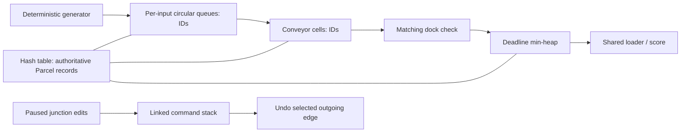

# Architecture

## The three modules

**Conveyor and Routing** (`src/module1_conveyor`) contains the manual circular queue, linked undo stack and synchronous conveyor engine. Its responsibilities are input admission, occupancy, merges, selected junction edges, emergency cell brakes and planning edits.

**Parcel Tracking and Dispatch** (`src/module2_dispatch`) contains the open-addressed hash registry, stable binary deadline heap and shared-loader system. It owns record lifecycle, one-time failure penalties, combo scoring and dispatch pacing.

**Shared Game and Presentation** (`src/shared`, `src/main.cpp`) defines four handcrafted graphs embedded in a grid, the deterministic simulation coordinator, isolated demonstration sequences and the Raylib application. `Game` owns input and fixed-step timing; `Renderer` reads state. `parcel_core` does not link Raylib.

## Data flow

`Simulation::step` increments time, attempts a generated parcel, expires overdue records and dispatches at most one ready parcel, then advances conveyors on the level's movement cadence. Dock arrivals stage parcels for a later tick's loader. The conveyor snapshots occupancy, rotates scan priority using the tick, and reserves destination cells. A parcel cannot enter a cell occupied at the beginning of that pass, even if its occupant moves away. This conservative rule prevents swaps, double moves and collision-dependent iteration behavior.

Cells and queues retain IDs, never pointers into the resizable registry. Expired IDs can remain physically in a queue/cell until its next cleanup pass, but are already terminal and never move or score again. Terminal records remain in the registry until reset for inspection. Stale heap entries are discarded before dispatch. Braking suspends the chosen cell and arrivals into it without changing identity.

## Lifecycle and reset

Normal progression is CREATED → QUEUED → ON_CONVEYOR → AT_DOCK → READY → DISPATCHED. Wrong docks produce REJECTED, fragile crusher entry produces BROKEN, and a deadline miss produces EXPIRED. Damaged parcels target the recycling dock; correct recycling follows the same loader path.

`Simulation::load` resets both modules, counters, jam, time and outcome. F4/Shift+F4, F5/R, retry and level cards all call this path. Skipping discards the current score and awards no victory; there is no persistent high-score storage. Level indices wrap in both directions.

## Timing, safety and presentation

Rendering runs at a target 60 FPS; logical ticks are 0.22 seconds, independent of render frame count. Frame delta is capped at 0.1 seconds so a stalled window cannot advance a long unattended burst. Each frame advances animation up to the next tick boundary, applies the simulation step, and then continues with any remaining frame time. Every simulation step clears planning history, so undo cannot rewind a completed tick.

`Game` stores a fixed array of `ParcelMotion` records indexed by parcel ID. Each record interpolates from its visible position to the next cell center using elapsed time divided by travel duration. Travel finishes slightly before the next routing decision. It does not change the logical occupancy or replace any DSA structure. Per-parcel status changes create feedback once; the stored outcome cell and points allow simultaneous outcomes to appear correctly. A fragile parcel finishes reaching the crusher before its failure effect appears.

Pause and the isolated F1-F3 demos freeze parcel movement, belts, deadlines, rushes, cooldowns and world effects. Paused switches still respond to clicks and stack undo. Junction arrows turn from their current angle toward the selected direction, so repeated clicks do not restart from an assumed angle. Each conveyor edge retains its own scroll offset across braking. Reset clears motion, effects and all animation timers alongside the simulation.

`Renderer.cpp` draws the factory and dashboard; `Screens.cpp` draws menus, level previews, results and the demonstrations. `Ui.cpp` provides small Raylib drawing helpers, font loading and shared button rectangles used by input and rendering. Geometry uses rectangles, lines, circles and basic arithmetic; there are no shaders, physics engine or animation dependencies. Open Sans font files and their license are included in `assets/fonts` and copied beside the executable by CMake. Fonts are resolved relative to the executable so Windows double-click and VS Code launches behave consistently. They are unloaded before closing the window. No external art or audio download is required.
