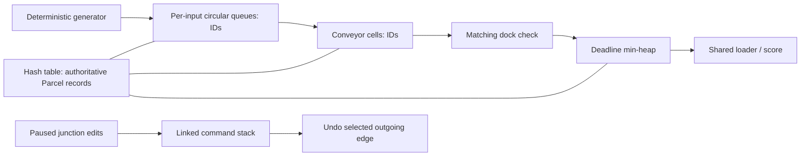

# Architecture

## The three modules

**Conveyor and Routing** (`src/module1_conveyor`) contains the manual circular queue, linked undo stack and synchronous conveyor engine. Its responsibilities are input admission, occupancy, merges, selected junction edges, emergency cell brakes and planning edits.

**Parcel Tracking and Dispatch** (`src/module2_dispatch`) contains the open-addressed hash registry, stable binary deadline heap and shared-loader system. It owns record lifecycle, one-time failure penalties, combo scoring and dispatch pacing.

**Shared Game and Presentation** (`src/shared`, `src/main.cpp`) defines four handcrafted graphs embedded in a grid, the deterministic simulation coordinator, isolated demonstration sequences and the Raylib application. `Game` owns input and fixed-step timing; `Renderer` reads state. `parcel_core` does not link Raylib.

## Data flow

`Simulation::step` increments time, attempts a generated parcel, expires overdue records and dispatches at most one ready parcel, then advances conveyors on the level's movement cadence. Dock arrivals stage parcels for a later tick's loader. The conveyor snapshots occupancy, rotates scan priority using the tick, and reserves destination cells. A parcel cannot enter a cell occupied at the beginning of that pass, even if its occupant moves away. This conservative rule prevents swaps, double moves and collision-dependent iteration behavior.

Cells and queues retain IDs, never pointers into the resizable registry. Expired IDs can remain physically in a queue/cell until its next cleanup pass, but are already terminal and never move or score again. Terminal records remain in the registry until reset for inspection. Stale heap entries are discarded before dispatch. Braking suspends the chosen cell and arrivals into it without changing identity.

## Lifecycle and reset

Normal progression is CREATED → QUEUED → ON_CONVEYOR → AT_DOCK → READY → DISPATCHED. Wrong docks produce REJECTED, fragile crusher entry produces BROKEN, and a deadline miss produces EXPIRED. Damaged parcels target the recycling dock; correct recycling follows the same loader path.

`Simulation::load` resets both modules, counters, jam, time and outcome. F4/Shift+F4, F5/R, retry and level cards all call this path. Skipping discards the current score and awards no victory; there is no persistent high-score storage. Level indices wrap in both directions.

## Timing, safety and presentation

Rendering runs at a target 60 FPS; logical ticks are 0.22 seconds, independent of render frame count. Frame delta is capped at 0.1 seconds so a stalled window cannot advance a long unattended burst. Parcel positions interpolate from previous/current grid cells. Pausing holds time, deadlines, rushes and cooldowns while input remains active. Every simulation step clears planning history, so undo cannot rewind a completed tick.

Menus, results, title banners, warning text, type markers, lifetime bars, particles and floating rewards use Raylib primitives and its embedded font. No external art, font or audio files are required. The isolated F1-F3 structures hold the simulation and expose physical storage after each Enter key operation.
