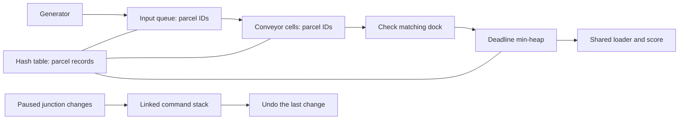

# How the game fits together

## Three modules

| Module | Files | Main jobs |
|---|---|---|
| Conveyor and Routing | `src/module1_conveyor` | Circular queues, linked undo stack, belt movement, merges, junctions and brakes |
| Parcel Tracking and Dispatch | `src/module2_dispatch` | Hash-table records, deadline heap, loader timing, parcel status, penalties and scoring |
| Shared Game and Presentation | `src/shared`, `src/main.cpp` | Four level layouts, simulation timing, input, menus, animation and DSA demos |

`Simulation` brings the first two modules together. `Game` handles the window, input and timing; `Renderer` reads the state to draw it. The `parcel_core` build target contains the game logic and DSA demos and does not need Raylib.

## Follow one parcel

The hash table holds the actual parcel records. Queues, cells and heap entries store IDs and look up those records when needed. They do not keep pointers into the table because growing the table moves its records to a new array.

A normal parcel passes through these statuses:

`Created → Queued → OnConveyor → AtDock → Ready → Dispatched`

`AtDock` is a brief check inside the arrival function. A wrong dock changes the status to `Rejected`; a fragile parcel entering a crusher becomes `Broken`; a missed deadline becomes `Expired`. Damaged parcels must reach recycling, then use the same heap and loader as other correct deliveries.

Finished records stay in the hash table until restart so they can still be inspected. An expired ID may remain in a queue, cell or heap until that structure next processes it. Its finished status prevents further movement, scoring or repeated penalties.

## What happens in one tick

`Simulation::step()` performs these operations in order:

1. Increase the tick counter and clear planning undo history.
2. Try to generate a parcel when an arrival is due. A full input queue makes it wait.
3. Check deadlines and let the shared loader dispatch at most one ready parcel when its loading interval allows it.
4. On a movement tick, move parcels, feed input queues onto belts and update congestion.
5. Check whether the level has ended.

Dock arrivals happen after that tick's loader check, so they wait until a later tick to be loaded.

During movement, `occupancy[]` remembers the cells occupied at the start, and `claimed[]` marks empty cells already taken in this pass. A parcel cannot enter a cell that was occupied at the start, even if its occupant moves away. This keeps one parcel per cell and prevents swaps and double moves. The scan starts at a different position each tick so one merge branch is not always checked first. A brake stops the chosen cell and movement into it.

## Time and animation

Graphics target 60 frames per second; the simulation advances once every **0.22 seconds**. A time accumulator decides when the next tick is due. Each frame advances animation to a tick boundary, runs the tick, then uses any remaining frame time. A single frame's time is capped at **0.1 seconds**, so a stalled window does not suddenly run many ticks.

`Game` keeps a fixed `ParcelMotion` array indexed by ID. Each visible parcel moves between cell centers using `elapsed / duration` as its progress. Travel finishes slightly before the next routing decision. These visual positions do not change logical cell occupancy or replace a data structure.

Each parcel's status change produces feedback once. Its `eventCell` and `pointsAwarded` keep the correct location and reward, including when several parcels finish together. A fragile parcel visually reaches the crusher before its failure effect appears. Junction arrows turn from their current angle, and each belt edge keeps its scrolling position when braked.

## Pause and restart

Pause and F1–F3 demos freeze the live simulation, parcels, belts, deadlines, rushes, cooldowns and world effects. Paused junction clicks and Z undo still update the junction arrow. The next simulation tick clears the undo stack, so it cannot rewind past parcel movement.

`Simulation::load()` resets the level's structures, counters, score, jam, time and outcome. The game also clears motion records, effects and animation timers. F4/Shift+F4, F5/R, Retry and level cards all use this reset path. Skipping wraps between the four levels, discards the old run and awards no victory. High scores are not saved between runs.

## Drawing and fonts

- `Renderer.cpp` draws the factory and sidebar.
- `Screens.cpp` draws menus, level previews, results and demos.
- `Ui.cpp` supplies shared button rectangles, drawing helpers and font loading.

Graphics use Raylib rectangles, lines, circles and basic maths. There are no extra shader, physics or animation libraries. Open Sans fonts and their license are included in `assets/fonts`; CMake copies them beside the EXE. Paths are based on the EXE's location so double-clicking and launching through VS Code find the same files. Fonts load after the window opens and unload before it closes. No separate art or audio download is needed.
